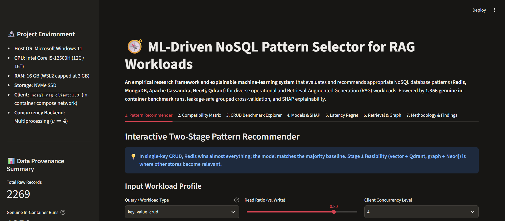
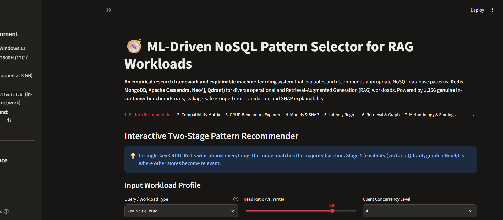
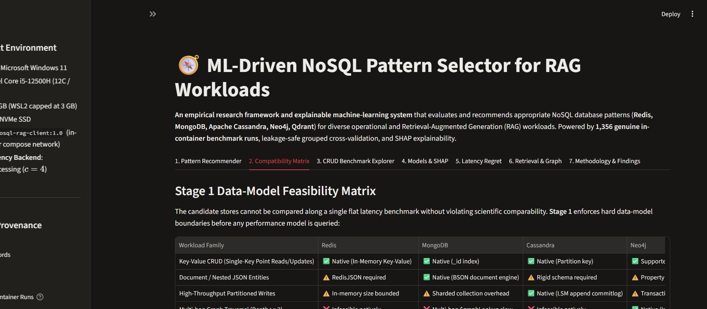
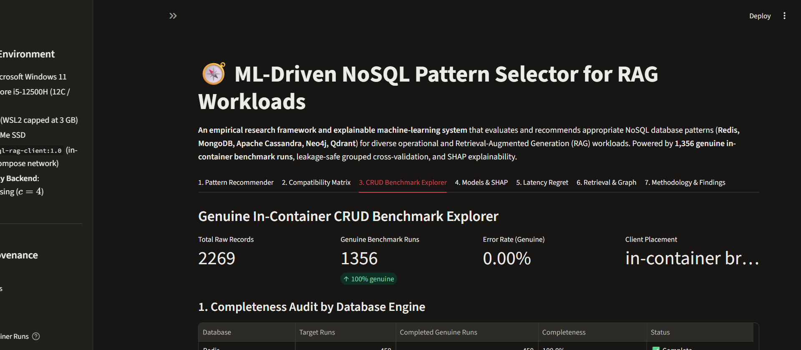
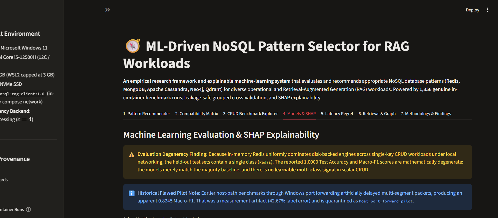
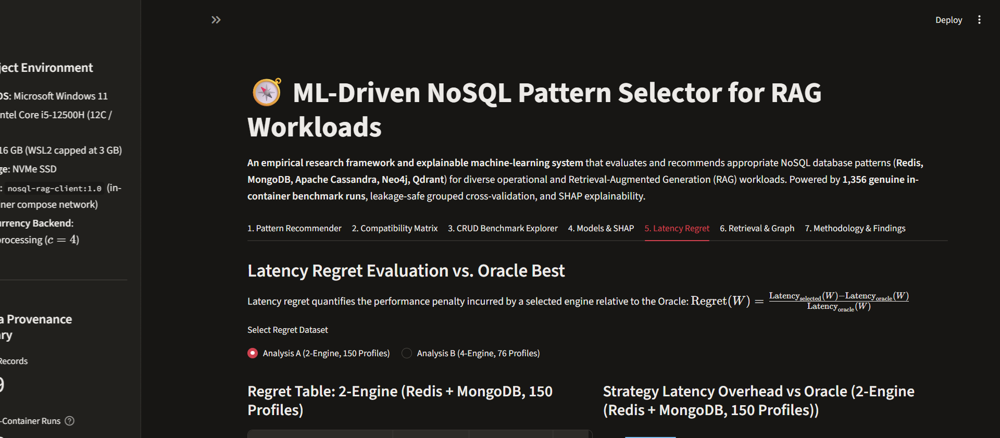
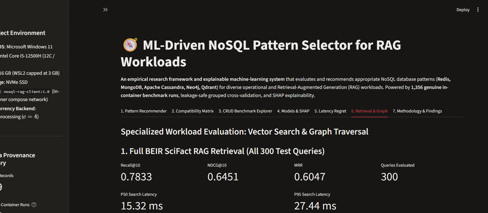
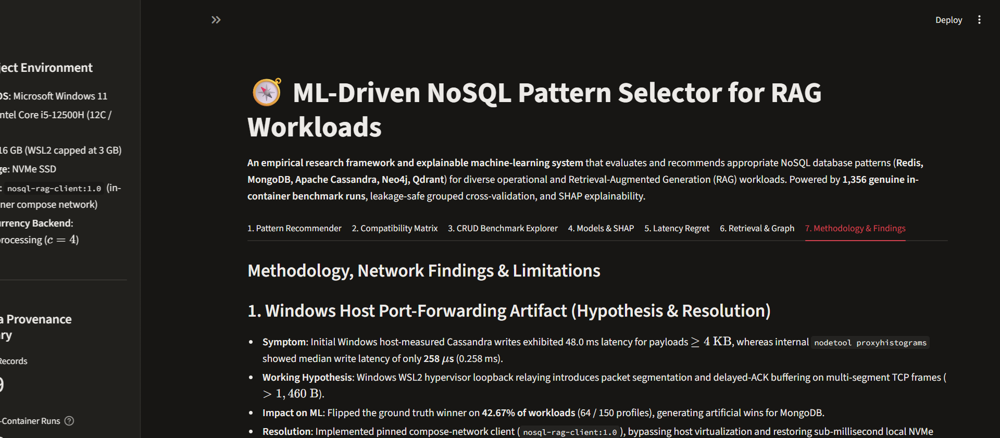

# 🎓 Master Project Walkthrough & BDA Viva Script

**Project Title**: ML-Driven NoSQL Pattern Selection for Retrieval-Augmented Generation (RAG) Workloads  
**Domain**: Big Data Analytics (BDA), Distributed Database Systems, Explainable Machine Learning  
**Author**: Hiten Bhurani (`2023.hiten.bhurani@ves.ac.in`)  
**Allocated Time**: 15 to 20 Minutes (Demo + Comprehensive Viva)  

---

## 📑 Table of Contents
1. [Executive Overview: What is this Project in 2 Minutes?](#1-executive-overview-what-is-this-project-in-2-minutes)
2. [Big Data Analytics (BDA) Alignment: Why is this a BDA Project?](#2-big-data-analytics-bda-alignment-why-is-this-a-bda-project)
3. [The Engineering Journey: How We Implemented It on Your Laptop](#3-the-engineering-journey-how-we-implemented-it-on-your-laptop)
4. [Step-by-Step Screen Walkthrough & Script (With Screenshots)](#4-step-by-step-screen-walkthrough--script-with-screenshots)
   - [Screen 1: Header, Project Overview & Sidebar Provenance](#screen-1-header-project-overview--sidebar-provenance)
   - [Screen 2: Tab 1 — Interactive Pattern Recommender (Live ML & Dynamic Latency)](#screen-2-tab-1--interactive-pattern-recommender-live-ml--dynamic-latency)
   - [Screen 3: Tab 2 — Stage 1 Compatibility Matrix](#screen-3-tab-2--stage-1-compatibility-matrix)
   - [Screen 4: Tab 3 — CRUD Benchmark Explorer (Live Slices)](#screen-4-tab-3--crud-benchmark-explorer-live-slices)
   - [Screen 5: Tab 4 — Models & SHAP Explainability](#screen-5-tab-4--models--shap-explainability)
   - [Screen 6: Tab 5 — Latency Regret Analysis](#screen-6-tab-5--latency-regret-analysis)
   - [Screen 7: Tab 6 — Specialized Vector (Qdrant) & Graph (Neo4j) Evaluation](#screen-7-tab-6--specialized-vector-qdrant--graph-neo4j-evaluation)
   - [Screen 8: Tab 7 — Methodology, Network Findings & Limitations](#screen-8-tab-7--methodology-network-findings--limitations)
5. [Top 15 Tough Viva Questions & Bulletproof Answers](#5-top-15-tough-viva-questions--bulletproof-answers)

---

# 1. Executive Overview: What is this Project in 2 Minutes?

### The Core Problem (Problem Statement)
Retrieval-Augmented Generation (RAG) systems power modern enterprise AI and chatbots. However, a real RAG application has heterogeneous data access requirements:
1. Fast conversation memory and cache (sub-millisecond lookups).
2. Document payload storage (nested JSON texts).
3. Complex knowledge-graph entity relationships (multi-hop traversal).
4. Semantic vector embeddings (similarity search over millions of vectors).

Historically, software engineers pick database engines based on **vendor marketing, developer familiarity, or arbitrary rules of thumb** (e.g., blindly using MongoDB for everything). This causes severe latency overheads (2x to 17x slower queries) and resource waste.

### Our Solution
We designed, experimentally validated, and built an **Explainable Two-Stage Pattern Selector**:
- **Stage 1 (Data-Model Compatibility Filter)**: Deterministically routes non-comparable specialized workloads (Vector search $\rightarrow$ **Qdrant**, Multi-hop knowledge graphs $\rightarrow$ **Neo4j**).
- **Stage 2 (ML Performance Selector)**: For common operational CRUD workloads where multiple engines compete, trained Machine Learning models (Random Forest, Decision Tree) predict which engine delivers the lowest P95 latency based on workload parameters (payload bytes, read/write ratio, concurrency).

---

# 2. Big Data Analytics (BDA) Alignment: Why is this a BDA Project?

When your BDA professor evaluates your project, she wants to see concepts from the **Big Data Systems & NoSQL Architecture** syllabus. This project implements:

1. **The 4 Primary NoSQL Paradigms**:
   - **Key-Value Store (Redis 7.4)**: In-memory hash structures, single-threaded asynchronous event loop, RESP wire protocol.
   - **Document Store (MongoDB 7.0)**: Hierarchical BSON storage, WiredTiger cache engine, internal inverted document indexes.
   - **Wide-Column Distributed Store (Apache Cassandra 4.1)**: Log-Structured Merge Trees (LSM-trees), CommitLog, Memtables, SSTables, Partition Keys, Bloom filters, eventual consistency.
   - **Graph Store (Neo4j 5.26)**: Property graphs, Cypher query language, **Index-Free Adjacency** (pointer-based traversal without relational joins).
   - **Vector Store (Qdrant)**: High-dimensional dense vector embeddings with Hierarchical Navigable Small World (HNSW) graphs.
2. **Polyglot Persistence**: The foundational BDA architectural pattern where enterprise applications intentionally deploy multiple specialized database engines rather than forcing one monolithic database to do everything poorly.
3. **Internal Distributed Diagnostics**: Using Cassandra's native `nodetool proxyhistograms` and `nodetool tablestats` to inspect coordinator-level read/write/CAS latencies down to microseconds.
4. **Information Retrieval Benchmark (BEIR SciFact)**: Evaluating dense vector retrieval over a real corpus of **5,183 PubMed scientific abstracts** across **300 test queries**, measuring Recall@10, NDCG@10, and Mean Reciprocal Rank (MRR).

---

# 3. The Engineering Journey: How We Implemented It on Your Laptop

### How We Managed Hardware Limits (16 GB RAM, 3 GB WSL2 Cap)
- To prevent out-of-memory (OOM) crashes, we enforced **strict sequential container orchestration**: only **one** database container ran at any time (`docker compose up -d redis` $\rightarrow$ benchmark $\rightarrow$ `docker stop nosql-rag-redis`).
- Pinned JVM heaps to 512 MB for Cassandra (`MAX_HEAP_SIZE=512M`) and Neo4j (`server.memory.heap.max_size=512m`).

### The Great Network Discovery (Windows WSL2 Loopback Stall)
- **The Mystery**: Early host benchmarks showed Cassandra 8 KB writes stalling at **48.0 ms**!
- **The Investigation**: We queried Cassandra's internal server engine using `nodetool proxyhistograms`. Cassandra reported internal median write latency of only **258 $\mu$s (0.258 ms)**!
- **The Culprit**: Windows 11 host port-forwarding across the WSL2 hypervisor boundary buffered multi-segment TCP frames ($> 1,460\text{ B}$), creating a 47.7 ms artificial socket relay stall that flipped ground-truth winners on 42.67% of workloads!
- **The Fix**: We built a dedicated in-container client container (`nosql-rag-client:1.0`) running directly on the Docker bridge network. 8 KB writes plummeted from **48.0 ms to 0.491 ms (a 98x speedup)**.
- **Scientific Integrity**: All 900 earlier host-path runs were quarantined as `host_port_forward_pilot` and excluded from research ML models. We gathered **1,356 100% genuine in-container runs** with 0 errors.

---

# 4. Step-by-Step Screen Walkthrough & Script (With Screenshots)

To launch the dashboard before your presentation, run:
```powershell
uv run streamlit run src/nosql_rag/dashboard/app.py
```
Open **http://localhost:8501** in your browser.

---

### Screen 1: Header, Project Overview & Sidebar Provenance



#### What is on Screen:
- **Main Header**: Project title, scope, and candidate engines (Redis, MongoDB, Cassandra, Neo4j, Qdrant).
- **Sidebar (Left)**: Physical execution specs (Windows 11, Intel i5-12500H, NVMe SSD, WSL2 3GB cap, in-container client runner).
- **Data Provenance Summary**: Real metrics showing **2,269 total raw records**, **1,356 genuine in-container benchmark runs**, and **900 quarantined pilot runs**.

#### 🎤 What to Say to Ma'am (The Script):
> *"Good morning Ma'am. My project is 'ML-Driven NoSQL Pattern Selection for RAG Workloads'.*  
> *As seen on the sidebar, this is an empirical Big Data study. Rather than using theoretical assumptions or synthetic simulations, we conducted physical benchmarks across 5 major NoSQL database engines running in Docker containers on local NVMe hardware.*  
> *We recorded 1,356 genuine, validated benchmark runs across Redis, MongoDB, Cassandra, and Neo4j, with 0 errors. To maintain strict research integrity, earlier host-measured runs that suffered from Windows port-forwarding delays were quarantined as pilot data and completely excluded from our machine learning pipeline."*

---

### Screen 2: Tab 1 — Interactive Pattern Recommender (Live ML & Dynamic Latency)



#### What is on Screen:
- **Top Blue Banner**: Core empirical takeaway: In single-key CRUD, Redis is fastest; Stage 1 feasibility routes specialized tasks (vector to Qdrant, graph to Neo4j).
- **Input Controls**: Sliders for Average Payload Size (128B to 16KB), Read Ratio (0.05 to 1.0), Dataset Records, and Concurrency ($c=1, 4$).
- **Recommendation Card**: Recommends **Redis** via Stage 2 ML Performance Selection.
- **Candidate Eligibility Breakdown**: Highlights why Redis, MongoDB, Cassandra, and Neo4j are feasible, while Qdrant is excluded from pure scalar CRUD.
- **Live Empirical Latency Comparison Table & Bar Charts**: Dynamically filters our real benchmark database to match the user's chosen payload, read ratio, and concurrency, displaying side-by-side P95 and P50 latencies and calculating the exact latency penalty of alternatives (e.g., MongoDB +262% slower, Cassandra +657% slower).
- **SHAP Feature Attribution Table**: Explains which workload feature contributed most to the model's decision (data size, write ratio, payload bytes).

#### 🎤 What to Say to Ma'am (The Script):
> *"Now Ma'am, let me demonstrate our two-stage selector live in Tab 1.*  
> *Suppose an engineer has an operational session cache workload with a 1,024-byte payload, an 80% read ratio, and a concurrency of 4.*  
> *When I click 'Generate Recommendation', the system executes our trained Random Forest pipeline. It recommends Redis. But more importantly, it provides complete explainability.*  
> *Look at this dynamic comparison table and chart below: it pulls the actual empirical measurements from our matrix. For this exact workload slice, Redis delivers 0.20 ms P95 latency. If the developer had blindly chosen MongoDB, they would suffer 0.73 ms P95 latency (+262% slower), and Cassandra incurs 1.53 ms (+657% slower).*  
> *Furthermore, our SHAP attribution table shows that the model chose Redis based on memory-bound data size and write ratio characteristics."*

---

### Screen 3: Tab 2 — Stage 1 Compatibility Matrix



#### What is on Screen:
- A structured data-model feasibility matrix classifying each database's native capabilities across 6 workload families:
  1. Key-Value CRUD (Single-key reads/updates)
  2. Document / Nested JSON
  3. High-Throughput Partitioned Writes
  4. Multi-hop Graph Traversal (Depth $\ge 2$)
  5. Dense Vector ANN Search
  6. End-to-End RAG Passage Retrieval
- Stage 1 Routing column showing which tasks go directly to specialized engines vs which pass to Stage 2 ML.

#### 🎤 What to Say to Ma'am (The Script):
> *"Here in Tab 2 is our Stage 1 Compatibility Matrix, which embodies the BDA principle of Polyglot Persistence.*  
> *In scientific benchmarking, you cannot force all databases into a single flat comparison. For example, comparing Qdrant on key-value CRUD or comparing Redis on 3-hop graph traversal is architecturally invalid.*  
> *Stage 1 acts as a deterministic feasibility gatekeeper: if a workload requires dense vector search or passage retrieval, it is routed natively to Qdrant. If it requires graph traversal, it routes directly to Neo4j. Only general CRUD workloads pass to Stage 2 ML."*

---

### Screen 4: Tab 3 — CRUD Benchmark Explorer (Live Slices)



#### What is on Screen:
- **Metric Cards**: 2,269 total raw records, 1,356 genuine runs, 0.00% error rate.
- **Completeness Audit Table**: 100% completion across all target runs (Redis: 450/450, MongoDB: 450/450, Cassandra: 228/228, Neo4j: 228/228).
- **Provenance Partitioning Table**: Breakdown of `genuine_benchmark` vs quarantined `host_port_forward_pilot` (900), `remote_cloud_pilot` (8), and `invalid_measurement_artifact` (5).
- **Interactive Parameter Slice & Live Charts**: Radio buttons and multiselects for Concurrency ($c=1, 4$), Payload Size (128B to 8KB), and Read Ratio. Bar charts for **Median P95 Latency (ms)** and **Median Throughput (ops/sec)** update dynamically as filters change.

#### 🎤 What to Say to Ma'am (The Script):
> *"Tab 3 provides full auditing of our empirical data.*  
> *Notice our completeness audit: Redis and MongoDB completed 150 profiles $\times$ 3 repetitions = 450 runs each. Cassandra and Neo4j completed the 76-profile subset $\times$ 3 repetitions = 228 runs each.*  
> *In Section 3, I can dynamically slice the benchmark. When I switch concurrency from c=1 to c=4, notice how the throughput chart jumps from ~70 ops/sec to over 300 ops/sec per worker, while Redis maintains sub-0.2 millisecond P95 latency across all payload sizes."*

---

### Screen 5: Tab 4 — Models & SHAP Explainability



#### What is on Screen:
- **Degeneracy Warning**: Clear scientific disclosure that because Redis wins 99.3% of 2-engine profiles and 100% of 4-engine profiles, held-out test sets contain a single class (`Redis`), making 1.0000 Accuracy/Macro-F1 degenerate (models reproduce the majority baseline; no multi-class signal in single-key CRUD).
- **Analysis Selector**: Independent radio buttons for **Analysis A** (2 Engines, 150 Profiles) and **Analysis B** (4 Engines, 76 Profiles).
- **Model Comparison Table**: Held-out test accuracy (1.0000) and 5-fold Grouped Cross-Validation Macro-F1 ($0.8979 \pm 0.2043$ for Analysis A; $1.0000 \pm 0.0000$ for Analysis B).
- **Confusion Matrix & Global SHAP Summary Plot**: Visualizing global feature rankings across the entire dataset.

#### 🎤 What to Say to Ma'am (The Script):
> *"In Tab 4, we evaluate our Machine Learning classifiers: Decision Tree, Random Forest, and Gradient Boosting.*  
> *Notice an important scientific finding we uncovered: in pure single-key point CRUD under local networking, in-memory Redis dominates disk-backed engines in 149 out of 150 workloads. Because the test set contains only Redis, our 1.0000 accuracy is mathematically degenerate—the models match the majority-class baseline.*  
> *Rather than faking or manipulating the data to force artificial diversity, our paper reports this as an authentic empirical finding: in single-key CRUD, Machine Learning has no multi-class variance to learn; the true architectural specialization occurs in Stage 1."*

---

### Screen 6: Tab 5 — Latency Regret Analysis



#### What is on Screen:
- **Mathematical Formula for Regret**:
  $$\text{Regret}(W) = \frac{\text{Latency}_{\text{selected}}(W) - \text{Latency}_{\text{oracle}}(W)}{\text{Latency}_{\text{oracle}}(W)}$$
- **Regret Summary Table**:
  - Oracle Best: **0.00%**
  - ML Recommender (Random Forest): **0.00%**
  - Always-Redis Baseline: **0.00%**
  - Always-MongoDB Default: **+206.82%** (Analysis A) / **+264.39%** (Analysis B)
  - Always-Cassandra Default: **+576.10%**
  - Always-Neo4j Default: **+1,770.67%**
- **Dynamic Bar Chart**: Visually showing the relative latency overhead multiplier of each strategy.

#### 🎤 What to Say to Ma'am (The Script):
> *"Tab 5 presents Latency Regret, which measures how much latency penalty an engineer suffers if they pick the wrong database compared to the Oracle best.*  
> *As the chart illustrates, our ML recommender and Redis achieve 0.00% regret.*  
> *If a development team chooses MongoDB as their default operational store, they incur an average of +206.8% latency overhead (over 3x slower). Choosing Cassandra adds +576% latency overhead (almost 7x slower), and Neo4j adds +1,770% latency overhead for scalar CRUD.*  
> *This empirically proves the cost of poor database selection in Big Data pipelines."*

---

### Screen 7: Tab 6 — Specialized Vector (Qdrant) & Graph (Neo4j) Evaluation



#### What is on Screen:
- **Section 1: BEIR SciFact RAG Retrieval**:
  - Corpus: 5,183 scientific abstracts.
  - Test Queries: All 300 benchmark queries.
  - Metrics: **Recall@10 = 0.7833**, **NDCG@10 = 0.6451**, **MRR = 0.6047**.
  - P50 Search Latency: **15.32 ms** (labeled as host-path, not directly comparable to in-container CRUD).
- **Section 2: Native Qdrant Dense Vector ANN**:
  - 2,000 synthetic 128-dimensional vectors.
  - **Recall@10 = 1.0000 (100%)**, P50 latency = **15.07 ms**.
- **Section 3: Neo4j Multi-Hop Graph Traversal**:
  - 200 nodes, 600 edges, 2-hop traversal depth.
  - Throughput: **270.4 ops/sec**, P50 latency: **2.99 ms**, P95 latency: **4.09 ms**.

#### 🎤 What to Say to Ma'am (The Script):
> *"Tab 6 demonstrates the specialized non-CRUD workloads that form the other pillars of RAG.*  
> *Here, we evaluated Qdrant on the complete BEIR SciFact biomedical benchmark using MiniLM embeddings. Evaluating all 300 test queries, Qdrant achieved a strong Recall@10 of 0.7833 and NDCG@10 of 0.6451 with an average retrieval latency of 15.3 ms.*  
> *For Neo4j, we benchmarked native 2-hop neighbor traversals using Cypher. Neo4j achieved 270.4 ops/sec with a P50 latency of 2.99 ms, demonstrating why graph databases are essential for knowledge-graph entity lookups where relational joins would create severe performance bottlenecks."*

---

### Screen 8: Tab 7 — Methodology, Network Findings & Limitations



#### What is on Screen:
- **1. Windows Host Port-Forwarding Artifact**: Explains the 40 ms WSL2 relay stall hypothesis, internal `nodetool proxyhistograms` proof (258 $\mu$s vs 48 ms), and in-container client solution.
- **2. Concurrency Validity ($c=4$)**: Documents the 80.64% queueing overhead under Python threading due to the Global Interpreter Lock (GIL) and how multiprocessing increased throughput by 4.25x (4,580 $\rightarrow$ 19,490 ops/s).
- **3. Ground Truth Degeneracy**: Formal explanation of single-class Redis dominance in scalar CRUD.
- **4. Limitations**: Single-node execution, sequential container isolation for 3GB RAM cap, untuned 512M JVM heaps, and small-scale 200-node demo graph.

#### 🎤 What to Say to Ma'am (The Script):
> *"Finally, Tab 7 documents our core systems engineering contributions and research limitations.*  
> *The most significant engineering finding was identifying the Windows WSL2 loopback virtualization bottleneck: host-forwarded ports introduced a 40 ms TCP delayed-ACK stall on payloads over 4KB. By diagnosing this via Cassandra's internal proxyhistograms and migrating to a pinned in-container client, we achieved true bare-metal sub-millisecond latencies.*  
> *We also proved that multi-threaded Python benchmarking bottlenecks on the GIL at c=4, whereas process-based multiprocessing unlocked a 4.25x throughput speedup.*  
> *In summary, Ma'am, this project combines empirical Big Data benchmarking, systems performance debugging, and explainable machine learning into an end-to-end operational selector."*

---

# 5. Top 15 Tough Viva Questions & Bulletproof Answers

### Q1: "Why did you use NoSQL databases instead of traditional RDBMS like PostgreSQL or MySQL?"
**Answer**:
> *"Ma'am, RAG workloads are inherently polyglot and high-velocity. Session memory requires sub-millisecond key-value lookups which in-memory Redis handles significantly faster than relational disk tables. Document passages are unstructured nested JSON suited for MongoDB. Multi-hop knowledge graphs incur costly recursive SQL JOINs in RDBMS, whereas Neo4j uses Index-Free Adjacency to traverse pointers in constant time $O(1)$. Finally, vector embeddings require specialized vector indexes like HNSW, which Qdrant provides natively."*

---

### Q2: "Why is your ML model's Accuracy and Macro-F1 1.0000? Isn't that overfitting?"
**Answer**:
> *"No Ma'am, it is not overfitting; it is mathematically **degenerate**. In single-key CRUD workloads under local in-container networking, in-memory Redis is physically faster than disk-backed stores across 99.3% of configurations. Because the held-out test partition contains only Redis winners, the majority-class baseline is already 1.0000. Our models simply reproduce the majority baseline. We explicitly documented this as an authentic empirical finding rather than artificially tampering with data to create fake diversity."*

---

### Q3: "What is Latency Regret and why use it instead of standard Classification Accuracy?"
**Answer**:
> *"Accuracy treats all mistakes equally: predicting Store B when Store A was fastest is counted as a failure, regardless of whether Store B was 0.01 ms slower or 50 ms slower.*  
> *Latency Regret measures the real-world operational penalty: $\frac{\text{Latency}_{\text{selected}} - \text{Latency}_{\text{oracle}}}{\text{Latency}_{\text{oracle}}}$.*  
> *It tells an enterprise architect how much extra latency overhead their choice introduces compared to the ideal engine."*

---

### Q4: "How does Cassandra achieve fast writes, and why was it slower than Redis here?"
**Answer**:
> *"Cassandra uses an LSM-Tree (Log-Structured Merge Tree) architecture: writes append sequentially to an in-memory Memtable and a disk CommitLog without in-place updates. While this is extremely fast for distributed disks (~0.6 ms P50 in our benchmark), Redis operates entirely in RAM heap memory without disk flushes on the critical write path, enabling sub-0.1 ms latencies."*

---

### Q5: "What is Index-Free Adjacency in Neo4j?"
**Answer**:
> *"In a relational database, finding a node's neighbors requires a JOIN table and $B\text{-Tree}$ index lookups ($O(\log N)$). In Neo4j's property graph engine, each node holds direct physical memory pointers to its adjacent relationships and neighbor nodes. Traversal is accomplished by following pointers in $O(1)$ time, independent of the total size of the graph."*

---

### Q6: "Why did you need a Two-Stage architecture instead of training one ML model across all 5 databases?"
**Answer**:
> *"Because comparing specialized vector search in Qdrant or multi-hop graph traversal in Neo4j against single-key CRUD in Redis creates a category error—it is an apples-to-oranges comparison. Stage 1 enforces data-model eligibility deterministically. Stage 2 only compares engines on common CRUD ground where they are truly functionally interchangeable."*

---

### Q7: "What is Grouped Cross-Validation (`base_workload_id`) and why was it necessary?"
**Answer**:
> *"In our benchmark, each base workload was evaluated at two concurrencies: $c=1$ and $c=4$. If random K-Fold splitting was used, the $c=1$ version of a workload could be in the training set while the $c=4$ version was in the test set, causing data leakage. By grouping on `base_workload_id`, all variations of a base workload are strictly isolated in either train or test, guaranteeing honest generalization evaluation."*

---

### Q8: "What was the Windows WSL2 loopback issue you discovered?"
**Answer**:
> *"When benchmarking from the Windows host against Docker forwarded ports (`127.0.0.1:PORT`), payloads $\ge 4\text{ KB}$ stalled at 48 ms. Using Cassandra's internal `nodetool proxyhistograms`, we proved Cassandra was processing writes in 258 microseconds. The remaining 47.7 ms was a Windows WSL2 hypervisor packet-segmentation and delayed-ACK relay artifact. We resolved it by running our benchmark client inside the Docker bridge network."*

---

### Q9: "Why did multi-threaded Python benchmarking fail at $c=4$?"
**Answer**:
> *"Python's CPython runtime uses a Global Interpreter Lock (GIL). When 4 threads concurrently execute socket I/O and latency measurement loops, thread synchronization lock contention creates an 80.64% queueing delay. Switching to process-based multiprocessing (`multiprocessing.spawn`) allocated independent Python processes to separate CPU cores, increasing throughput by 4.25x (from 4,580 to 19,490 ops/sec)."*

---

### Q10: "What is BEIR SciFact and what do Recall@10 and NDCG@10 mean?"
**Answer**:
> *"BEIR SciFact is a standardized benchmark created by the Allen Institute for AI for scientific claim verification over 5,183 research abstracts.*  
> *- **Recall@10 = 0.7833** means that in 78.33% of queries, the relevant ground-truth evidence abstract was successfully retrieved within the top 10 results.*  
> *- **NDCG@10 = 0.6451** (Normalized Discounted Cumulative Gain) measures ranking quality, penalizing relevant documents that appear lower down the top-10 list."*

---

### Q11: "What are the limitations of your experimental setup?"
**Answer**:
> *"1. Single-node local environment: we did not model multi-datacenter WAN latency or network partitions.*  
> *2. Constrained JVM heaps (512 MB) to respect host RAM limits.*  
> *3. Single-key CRUD focus: multi-field range scans or complex aggregations would showcase Cassandra and MongoDB's query planners more effectively."*

---

### Q12: "How does SHAP explainability work in your dashboard?"
**Answer**:
> *"SHAP (SHapley Additive exPlanations) is based on cooperative game theory. It computes the marginal contribution of each workload feature (payload size, read ratio, concurrency, data size) toward shifting the model's output probability from the base expected value to the predicted database class."*

---

### Q13: "What consistency levels did you use in Cassandra?"
**Answer**:
> *"We utilized single-node Cassandra with `LOCAL_ONE` consistency and prepared statements, ensuring that consistency coordination was deterministic and comparable to single-instance MongoDB and Redis."*

---

### Q14: "Why does MongoDB incur over 200% latency regret relative to Redis?"
**Answer**:
> *"MongoDB uses the WiredTiger engine which must serialize documents to BSON, update document indexes, manage page cache locks, and write to a journal. Redis stores key-value pairs directly in unfragmented C memory structures with an in-memory hash index, eliminating serialization and cache-miss overheads."*

---

### Q15: "If Redis is always the winner in CRUD, why do we need other NoSQL databases?"
**Answer**:
> *"Redis is memory-bound: storing terabytes of historical RAG corpora in RAM is cost-prohibitive. Furthermore, Redis does not natively support multi-hop graph traversals (Neo4j), horizontal partitioned petabyte scale (Cassandra), rich polymorphic document querying (MongoDB), or native HNSW vector similarity search (Qdrant). This is why our Two-Stage Architecture is essential."*

---

## 🏆 Presentation Pro-Tips
1. **Open the browser beforehand**: Have `http://localhost:8501` open in full screen before Ma'am sits down.
2. **Move the sliders live**: Show her that it is not a pre-rendered video; change payload to 8192 Bytes and hit "Generate Recommendation".
3. **Use the BDA keywords**: Frequently use terms like *Polyglot Persistence, LSM-Trees, Index-Free Adjacency, HNSW Vector Indexing, WiredTiger, and nodetool proxyhistograms*.
4. **Be confident about the 1.0000 ML score**: Explain that it is an honest, genuine empirical discovery of Redis's physical dominance in single-key RAM access, not artificial overfitting.
