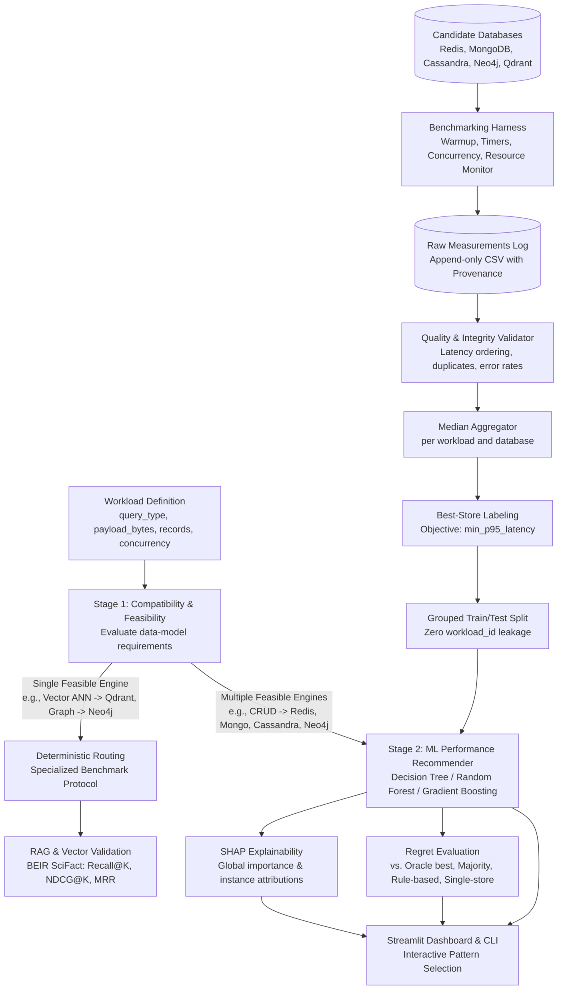

# System Architecture

## 1. End-to-End Modular Pipeline

## 2. Package Architecture (`src/nosql_rag/`)

- `config.py`: Strict Pydantic models for database credentials, experiment parameters, paths, and logging.
- `workloads/`:
  - `compatibility.py`: Stage 1 feasibility engine.
  - `generator.py`: Reproducible workload profile generation and deterministic payload synthesis.
- `adapters/`:
  - `base.py`: Abstract `BaseAdapter` and `BaseCRUDAdapter`.
  - `crud.py`: Concrete adapters for Redis, MongoDB, Cassandra, Neo4j.
  - `qdrant_adapter.py`: Concrete adapter for Qdrant vector database.
- `benchmarking/`:
  - `runner.py`: Benchmark harness with warm-up, thread-pool concurrency, timeout guards, and process resource tracking.
- `data/`:
  - `schemas.py`: `DataProvenance` enums and required columns contract.
  - `validator.py`: Automated dataset sanity and synthetic contamination guards.
  - `persistence.py`: Append-only raw run logging and median aggregation.
- `features/`:
  - `pipeline.py`: Preprocessor ColumnTransformer, target-derived column rejection, and `GroupShuffleSplit`.
- `models/`:
  - `training.py`: Decision Tree, Random Forest, Gradient Boosting estimators, StratifiedGroupKFold CV, and artifact serialization.
  - `inference.py`: Two-stage inference pipeline with generalization warnings.
- `explainability/`:
  - `shap_explainer.py`: Multi-class TreeExplainer global importance and per-instance feature contributions.
- `evaluation/`:
  - `regret.py`: Feasibility-aware relative latency regret calculation against Oracle, Random, Majority, and Rule-based baselines.
- `rag/`:
  - `qdrant_benchmark.py`: Seeded ANN latency/recall benchmark and BEIR SciFact passage retrieval experiment.
- `dashboard/`:
  - `app.py`: Interactive Streamlit application with explicit provenance banners.
- `cli.py`: Unified `nosql-rag` command-line tool.
