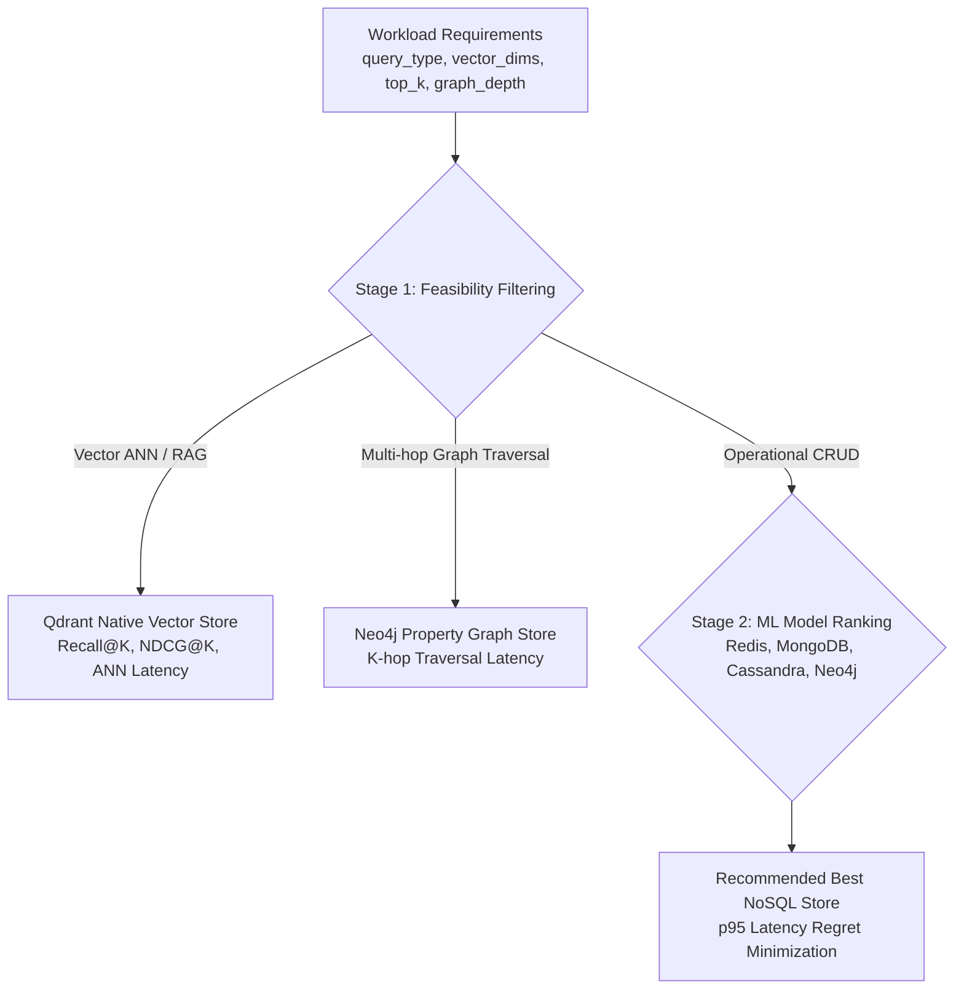

# Methodology Validation Report

Audit Date: 2026-11-12
Scope: Methodological consistency, feasibility boundaries, and regret formulation

---

## 1. Two-Stage Recommendation Architecture

### Validation of Data-Model Comparability
1. **Rejection of Flat 5-Class Classifier:** The decision to avoid a naive 5-class classifier across Redis, MongoDB, Cassandra, Neo4j, and Qdrant is methodologically sound and scientifically defensible.
2. **Qdrant Isolation:** Vector databases are specialized for high-dimensional approximate nearest neighbor search and payload filtering. Comparing Qdrant on key-value `SET`/`GET` latency or comparing Redis on high-dimensional HNSW ANN without specialized modules would produce unscientific conclusions.
3. **Neo4j Graph Isolation:** Multi-hop graph traversals (depth $\ge 2$) require index-free adjacency.

---

## 2. Regret Formulation & Baselines

Relative latency regret for workload $W_i$ is computed as:

$$\text{Regret}(W_i) = \frac{\text{Latency}_{\text{selected}}(W_i) - \min_{d \in \text{Feasible}(W_i)} \text{Latency}_d(W_i)}{\min_{d \in \text{Feasible}(W_i)} \text{Latency}_d(W_i)}$$

### Baselining Strategy
- **Oracle Best Feasible Store:** Lowest p95 latency among feasible candidates. Regret is strictly $0.0$.
- **Random Baseline:** Uniform random choice among **feasible** candidates (not blind across all 5).
- **Majority-Class Baseline:** Most frequent winning store in the training split.
- **Rule-Based Baseline:**
  - `key_value_crud` $\to$ Redis
  - `document_crud` $\to$ MongoDB
  - `wide_column_crud` $\to$ Cassandra
  - `graph_traversal` $\to$ Neo4j
  - `vector_similarity` / `rag_retrieval` $\to$ Qdrant
- **Single-Store Default:** MongoDB (as a general-purpose multi-model operational document default).

---

## 3. RAG Case Study Validation (BEIR SciFact)

- **Corpus:** 5,183 scientific abstracts from BEIR SciFact.
- **Encoder:** `sentence-transformers/all-MiniLM-L6-v2` (384-dimensional dense vectors, normalized).
- **Index:** Qdrant HNSW collection with cosine distance.
- **Metrics:** Recall@10, NDCG@10, and Mean Reciprocal Rank (MRR).
- **Distinction from Generative Evaluation:** The evaluation explicitly measures **retrieval quality** and **query latency**. It does not make unsupported claims about end-to-end LLM answer generation or hallucination rates, as LLM answer generation is outside database system boundaries.
