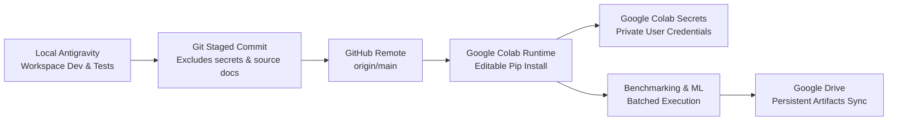

# GitHub Repository Setup and Colab Integration Guide

Workflow and protocol for version control, package distribution, and Google Colab execution for `nosql-rag-research`.

---

## 1. End-to-End Workflow Architecture



---

## 2. GitHub Version Control Protocol

### 2.1 Branch & Remote Target
- **Remote:** `https://github.com/hitenBhurani07/nosql-rag-research.git`
- **Branch:** `main`
- **Author Identity:** `Hiten Bhurani <2023.hiten.bhurani@ves.ac.in>`

### 2.2 Security Exclusion Guarantee
The repository enforces exclusion of sensitive, private, and temporary files via `.gitignore`:
- **Credentials & Environments:** `.env`, `.env.*`, `.venv/`
- **Unpublished Source Materials:** `docs/source/*` (including private research briefs)
- **Local Data & Output Cache:** `data/raw/*`, `data/processed/*`, `results/models/*`, `results/benchmarks/*`, `logs/*`
- **Build Artifacts:** `__pycache__/`, `*.egg-info/`, `.pytest_cache/`

---

## 3. Package Installation in Google Colab

Google Colab connects directly to the GitHub repository to load `nosql_rag` as a native Python package without duplicating code inside notebook cells.

### Scenario A: Public GitHub Repository
If the repository is public, a fresh Colab runtime installs the package directly in editable mode:
```bash
# Clone the repository
!git clone https://github.com/hitenBhurani07/nosql-rag-research.git
%cd nosql-rag-research

# Install dependencies and package
!pip install -q redis pymongo cassandra-driver neo4j qdrant-client sentence-transformers beir shap streamlit
!pip install -q -e .
```

### Scenario B: Private GitHub Repository
If the repository is private, **NEVER embed personal access tokens in notebook source cells**. Instead, use Google Colab Secrets:
1. In Colab, add a secret named `GITHUB_TOKEN` with `repo` read permission.
2. Clone securely in memory:
   ```python
   from google.colab import userdata
   import os

   token = userdata.get('GITHUB_TOKEN')
   repo_url = f"https://{token}@github.com/hitenBhurani07/nosql-rag-research.git"
   !git clone -q {repo_url}
   %cd nosql-rag-research
   !pip install -q -e .
   ```

---

## 4. Google Drive Persistence Protocol

Google Colab runtimes reset after disconnection or inactivity. To preserve genuine benchmark runs, trained models, and figures:
1. Enable `USE_GOOGLE_DRIVE = True` in Cell 8 of [notebooks/NoSQL_RAG_Implementation_Colab.ipynb](file:///c:/Users/hiten/nosql-rag-research/notebooks/NoSQL_RAG_Implementation_Colab.ipynb).
2. The notebook binds the project root to:
   ```text
   /content/drive/MyDrive/NoSQL_RAG_Research/
   ```
3. All append-only raw CSVs (`data/raw/crud_benchmark_runs.csv`) and trained pipelines (`results/models/best_nosql_recommender.joblib`) are flushed directly to persistent storage.
