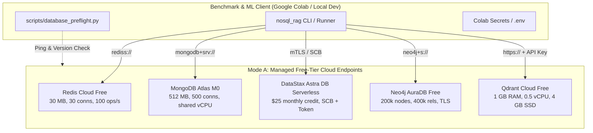

# Infrastructure Architecture and Deployment Configurations

## 1. Executive Summary

This architecture specifies two distinct infrastructure deployment strategies for the **ML-Driven NoSQL Pattern Selection for Retrieval-Augmented Generation Workloads** research framework:

1. **Architecture Mode A (Free-Tier Pipeline Validation):** Utilizes official, managed, zero-cost cloud tiers across 5 specialized providers (Redis Cloud, MongoDB Atlas, DataStax Astra DB, Neo4j AuraDB, Qdrant Cloud) to validate adapters, authentication, schema creation, data persistence, and pre-flight health checks.
2. **Architecture Mode B (Controlled Research Benchmarking):** Deploys a dedicated, co-located compute environment (e.g., Oracle Cloud Infrastructure Always Free Ampere A1 or a single standardized multi-core cloud VM) where database engines are benchmarked under identical OS, network round-trip, CPU, and RAM conditions.

---

## 2. Architecture Mode A: Free-Tier Validation Pipeline



### Purpose and Scientific Role
- **Validation Scope:** Authentication protocols, TLS/mTLS handshakes, schema creation, payload serialization, query execution, latency recording, timeout handling, and cleanup.
- **Scientific Integrity Boundary:** **Measurements collected in Mode A MUST be tagged as `pilot_benchmark` or `free_tier_validation`**. Because these databases run on heterogeneous cloud infrastructures (different AWS/GCP regions, unknown underlying hypervisors, and variable network transit latencies), **they cannot be used as primary proof of a scientifically pure latency ranking across database paradigms.**

---

## 3. Architecture Mode B: Controlled Research Benchmarking

```mermaid
flowchart TD
    subgraph ControlledVM["Architecture B: Controlled Single-Node / Co-located Host"]
        subgraph SequentialEngines["Sequential Containerized Database Deployments"]
            D1[Redis 7.2\nIsolated 4 GB RAM, 2 vCPU]
            D2[MongoDB 7.0\nIsolated 4 GB RAM, 2 vCPU]
            D3[Apache Cassandra 5.0\nIsolated 4 GB RAM, 2 vCPU]
            D4[Neo4j 5.20\nIsolated 4 GB RAM, 2 vCPU]
            D5[Qdrant 1.9\nIsolated 4 GB RAM, 2 vCPU]
        end
        BENCH[nosql_rag Benchmark Harness\nCo-located Client (Zero Network Jitter)]
        SYS[Host Resource Monitor\nTrue Server-Side CPU & RAM Telemetry]
    end

    BENCH -->|Loopback / IPC| SequentialEngines
    SYS -.->|Telemetry| BENCH
```

### Why Controlled Architecture B is Scientifically Superior
1. **Network Equivalence:** In Mode A, network RTT between Google Colab (often US-West or US-Central) and heterogeneous database hosting regions (e.g., AWS us-east-1 vs. GCP europe-west1) can dominate latency measurements, rendering database engine efficiency invisible. Mode B eliminates network variance by co-locating the runner and target server on a unified host (loopback network).
2. **Hardware Parity:** All engines execute on identical physical hardware architectures, CPU instruction sets, RAM speeds, and NVMe SSD backings.
3. **Sequential Execution:** The benchmark runner executes one database at a time, completely tearing down the previous container and clearing page caches (`sync; echo 3 > /proc/sys/vm/drop_caches`) between runs. This fits comfortably within a 12–16 GB RAM envelope.
4. **Server-Side Telemetry:** Real database process CPU usage, memory RSS, and disk I/O are captured directly via host cgroups, resolving the client-only limitation.

---

## 4. Methodological Recommendation

| Phase | Recommended Architecture | Primary Justification | Cost |
| --- | --- | --- | --- |
| **Phase 14 (Pre-Flight & Pilot Verification)** | **Mode A (Free-Tier Managed Services)** | Validates all adapters, credentials, and notebook workflows immediately with zero infrastructure provisioning overhead. | **$0.00** |
| **Phase 15+ (Final Publication Benchmarks)** | **Mode B (Controlled Sequential Host)** | Provides scientifically rigorous, peer-reviewable performance comparisons free of cross-cloud network bias. | **$0.00** (via OCI Always Free) or ~**$1–$3** (via hourly cloud spot VM) |
